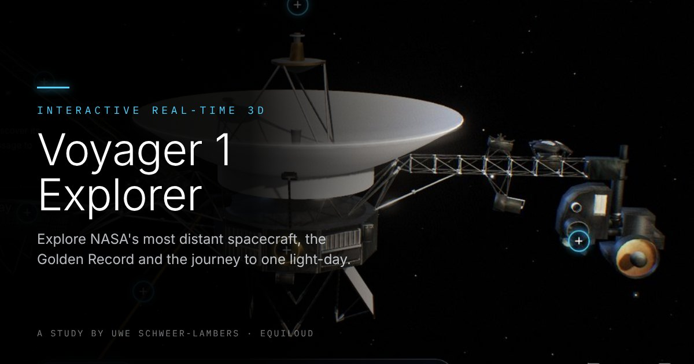

# Voyager 1 Explorer

Interactive real-time 3D presentation of NASA's Voyager 1 probe, built with three.js. Explore the spacecraft and its instruments via hotspots, flip the Golden Record and follow the journey to one light-day from Earth, with a live countdown and distance counter.

**Live:** https://uschweerlambers-art.github.io/voyager-explorer/



## Features

- **Spacecraft** – orbit and zoom (limited) around NASA's Voyager model; cinematic look with bloom, ACES tone mapping and film grain; a starfield drifts past the spacecraft.
- **Instruments** – six hotspots (high-gain antenna, cameras, Golden Record, RTG power source, magnetometer boom, plasma wave antennas) with a shared info panel and live-rendered close-ups.
- **Golden Record** – a chapter of its own: rotate the disc, flip between cover and record, six topics.
- **Mission** – timeline from 1977 to one light-day, countdown to Nov 18, 2026 (switches to “time since” afterwards) and a distance counter in miles or kilometers.
- **Sound** – synthesized ambient pads with reverb (Web Audio), can be switched off.

## Structure

```
index.html          Landing page (hero with the presentation, about, features, sources, FAQ)
app/index.html      The presentation (16:9, self-contained)
app/assets/         3D model, textures, images
app/lib/            three.js r169 (only the modules used) and self-hosted fonts
assets/             Screenshots, social preview image, favicon
```

No build step and no external requests: three.js and the fonts are self-hosted.

## Run locally

Serve the folder with any static web server (ES modules do not load from `file://`):

```sh
python3 -m http.server 8000
# then open http://localhost:8000/
```

## Embedding

The presentation can be embedded as a 16:9 iframe:

```html
<div style="position:relative;width:100%;aspect-ratio:16/9">
  <iframe src="https://uschweerlambers-art.github.io/voyager-explorer/app/"
          style="position:absolute;inset:0;width:100%;height:100%;border:0"
          title="Voyager 1 Explorer" allow="fullscreen; autoplay" allowfullscreen loading="lazy"></iframe>
</div>
```

Optional URL parameters for `app/index.html`: `?view=instr|record|mission` (opens a chapter after the start), `?sound=0` (starts muted).

## Credits & license

- Code: [MIT License](LICENSE) © 2026 Uwe Schweer-Lambers · EQUILOUD – Motion Graphics & 3D Animation
- 3D model and images: NASA/JPL-Caltech; Jupiter texture: Solar System Scope (CC BY 4.0). Full list in [CREDITS.md](CREDITS.md).
- Not affiliated with or endorsed by NASA or JPL.
